# Entra ID Privileged Identity Management (PIM)

Hands-on lab, Oct 2026.

Standing admin rights are one of the easiest ways for an attacker, or a mistake, to do real damage. PIM fixes that with just-in-time access: nobody holds the role full-time. They're only *eligible*, and they have to ask for it, give a reason, pass MFA, and get approved, and then it expires on its own. In this lab I set that up for the User Administrator role and walked a request all the way through, from eligible to active to expired, with the audit log as proof.

## What I built

- Made Test User **eligible** (not active) for the **User Administrator** role in Entra PIM. The assignment type is Eligible and permanently eligible, so they have no standing access.
- Role settings for User Administrator: activation max **1 hour**, **Azure MFA** required, **justification** required, and **approval** required, with me (Lab Admin) as the approver.
- Signed in as Test User and requested activation for 1 hour with the reason "reset a user's password". The request sat at **Pending approval**.
- As Lab Admin I reviewed the request and approved it with a justification.
- The role went **Activated**, with an end time one hour after it started.
- Tried to deactivate early, hit the 5-minute minimum rule, waited, and then deactivated successfully.
- Checked the PIM **Resource audit**, which records every assignment, settings change, request, approval and deactivation, including the failed attempts.

## What I learned

His own words (lightly cleaned up):

> I made Test get access to User Administrator only when they needed it. They have to get permission and request access in order to have that role or that power, and they had it for only one hour. I saw what they did in the log, and everything was recorded. I also hit an error: you have to wait at least 5 minutes before deactivating their privilege.

*Interview line (coach-written at his request, from his one-page IAM Labs doc):*

> "I set up Entra PIM so Test User was only eligible for User Administrator. To use it, they had to request it with a reason, pass MFA, and get my approval, and it expired after one hour. Every step showed up in the PIM audit log. I also hit a real rule: you can't deactivate a role in its first 5 minutes."

## Key screenshots

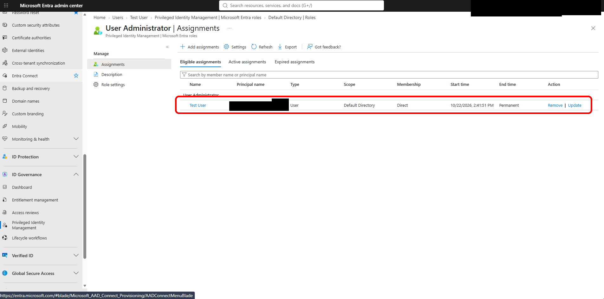
*Test User is only eligible, not permanently active, for User Administrator.*

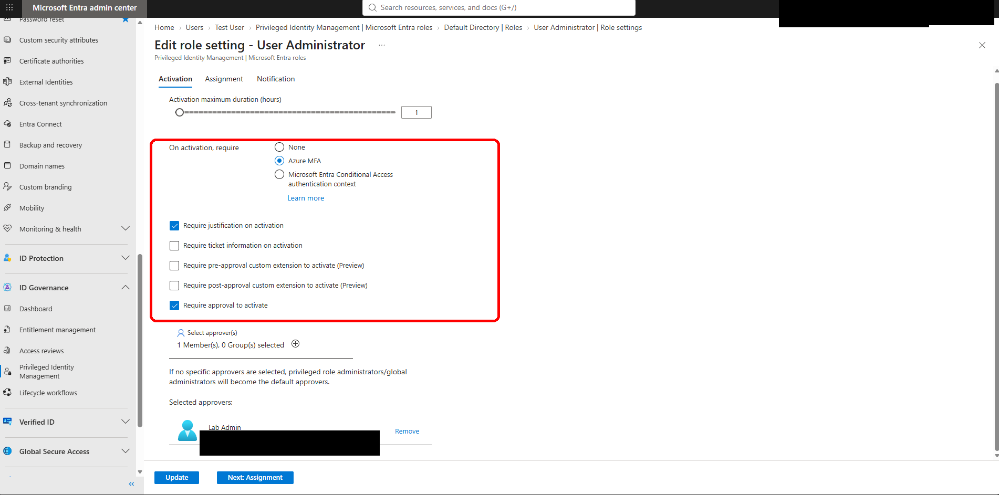
*Role settings: one-hour max, MFA, justification and my approval required.*

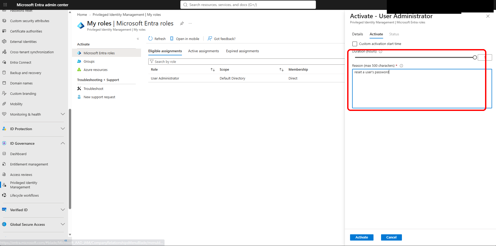
*Test User requests activation for one hour with a written reason.*

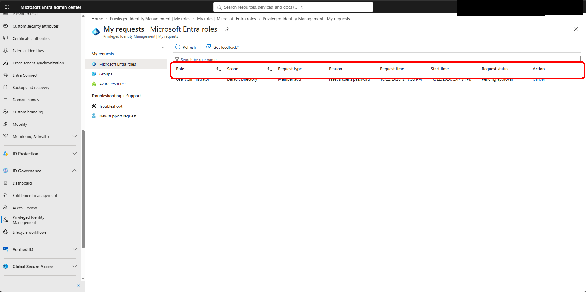
*The activation request waits as Pending approval until an admin acts.*

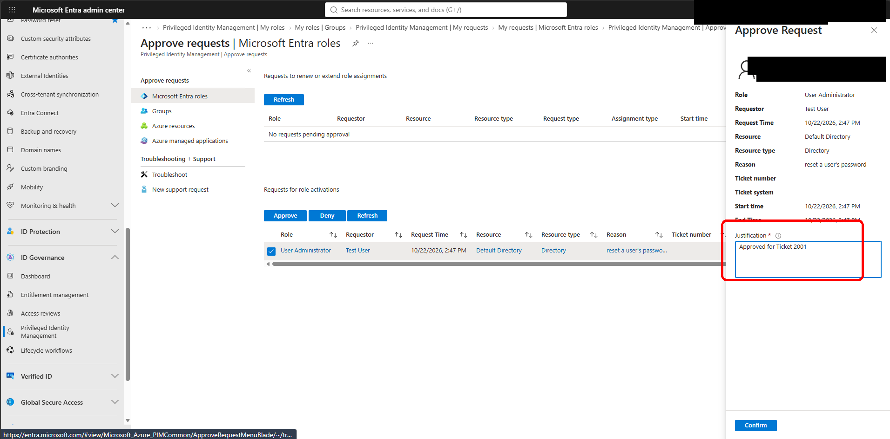
*As labadmin I review the reason and approve the request.*

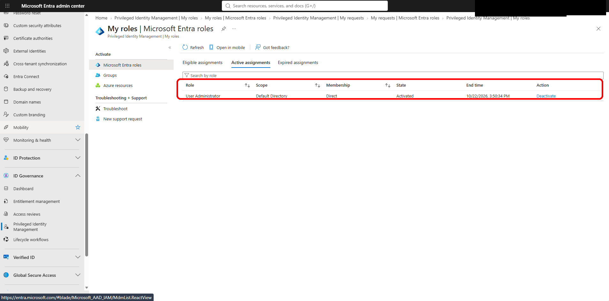
*Role is active and automatically expires one hour after approval.*

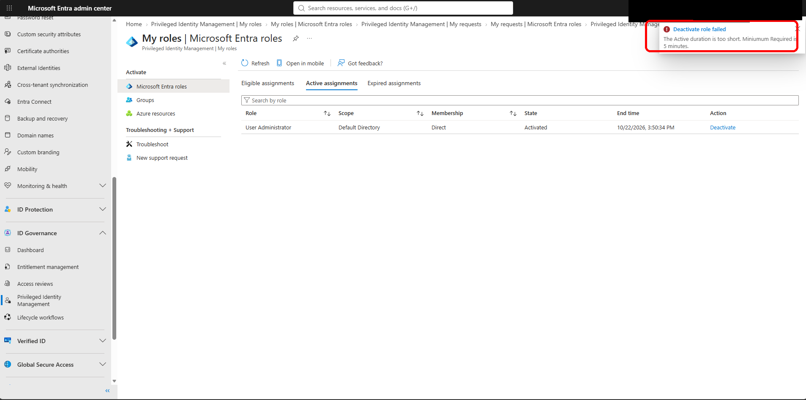
*Error I hit: PIM blocks deactivation in the first five minutes.*

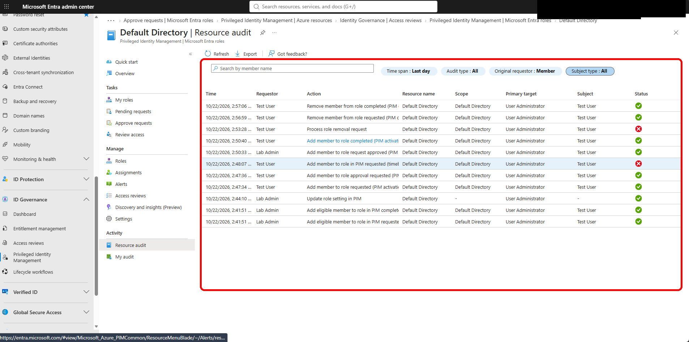
*The PIM resource audit log records every request, approval and change.*

## Environment

| Piece | What I used |
|---|---|
| Identity | Microsoft Entra ID lab tenant with an Entra ID P2 license (needed for PIM) |
| Role | User Administrator (Microsoft Entra role, Directory scope) |
| Accounts | Lab Admin (approver), Test User (requester) |
| Tool | Entra admin center > ID Governance > Privileged Identity Management |

## What broke / issues I fixed

- **5-minute minimum before deactivation.** When I tried to deactivate right after activation (started 2:50 PM PT), PIM refused. The error says a role can't be deactivated within its first 5 minutes. I waited and retried, and the deactivation succeeded.
- Test User's account had been disabled from an earlier lab. I re-enabled it first so Test User could sign in and make the request.
- The audit log also shows an earlier activation request that failed, before the successful one. I'm leaving it in as part of the honest trail.

## Gaps

- I didn't capture a screenshot of the MFA prompt itself during activation. The proof is the role setting that requires it.
- The role expired or was deactivated, but I didn't screenshot the Expired assignments tab. The deactivation success message and the audit log cover it.
- I didn't test what Test User could actually do with User Administrator while it was active.
- There was one approver (me). There's no separate approver group and no notification email review.

Full proof (all screenshots)

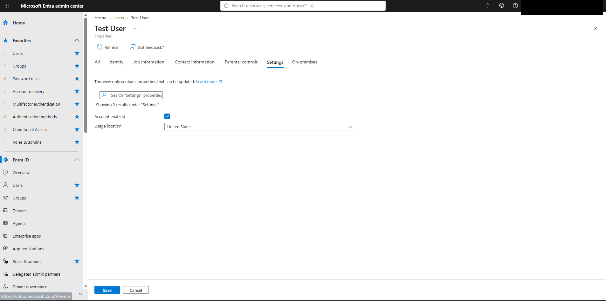

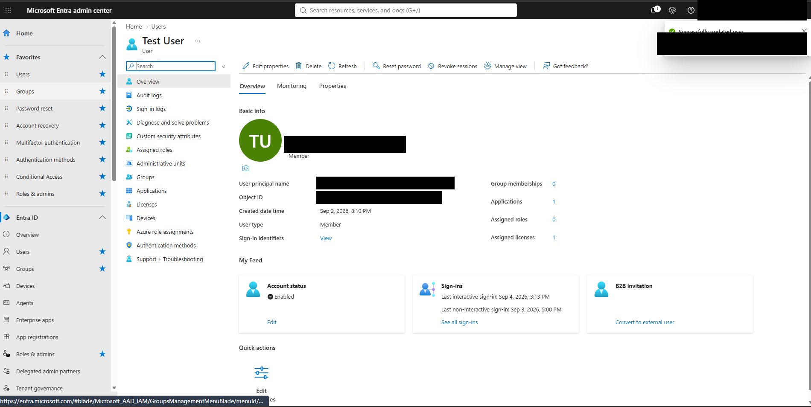

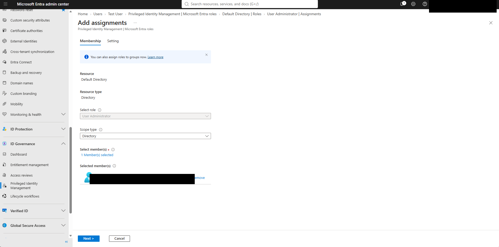

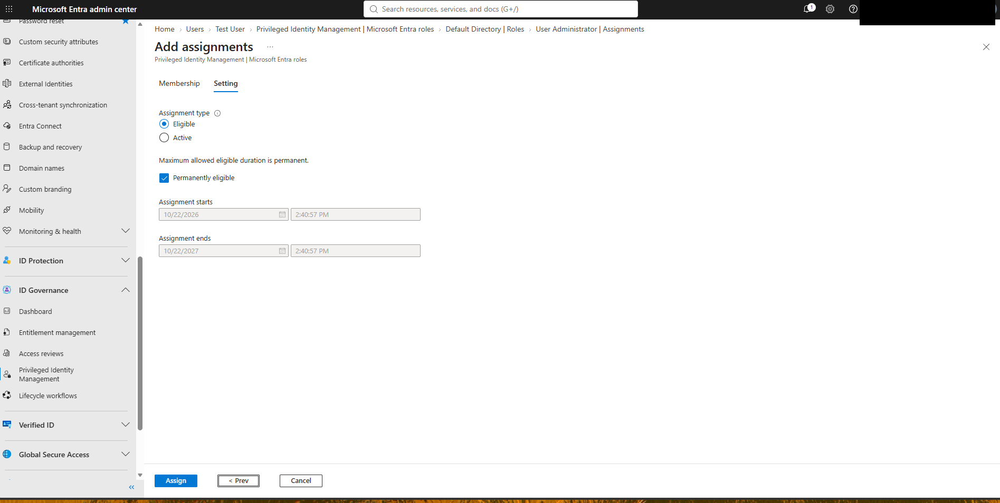

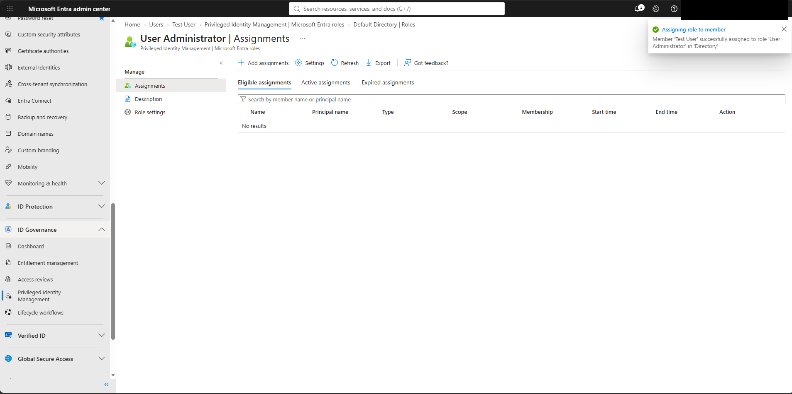

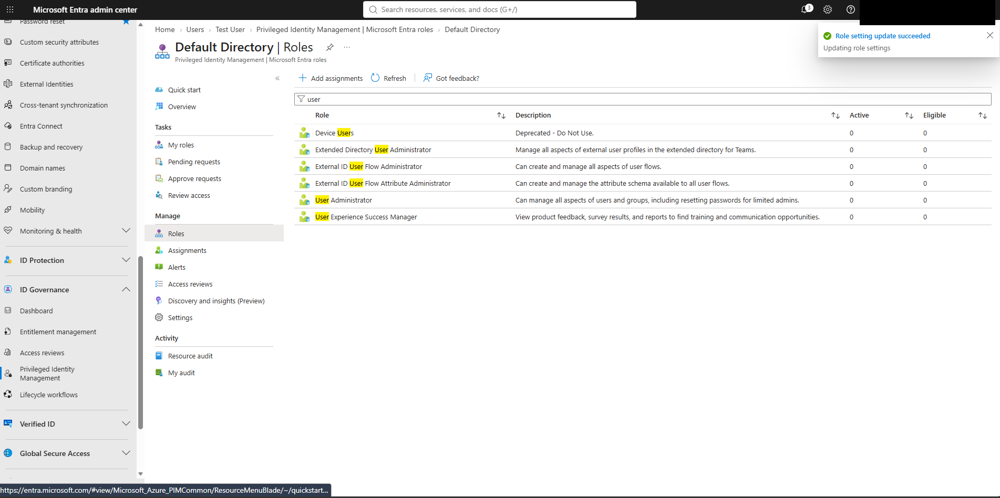

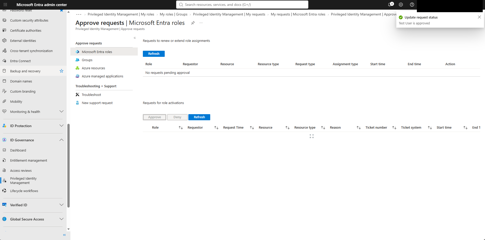

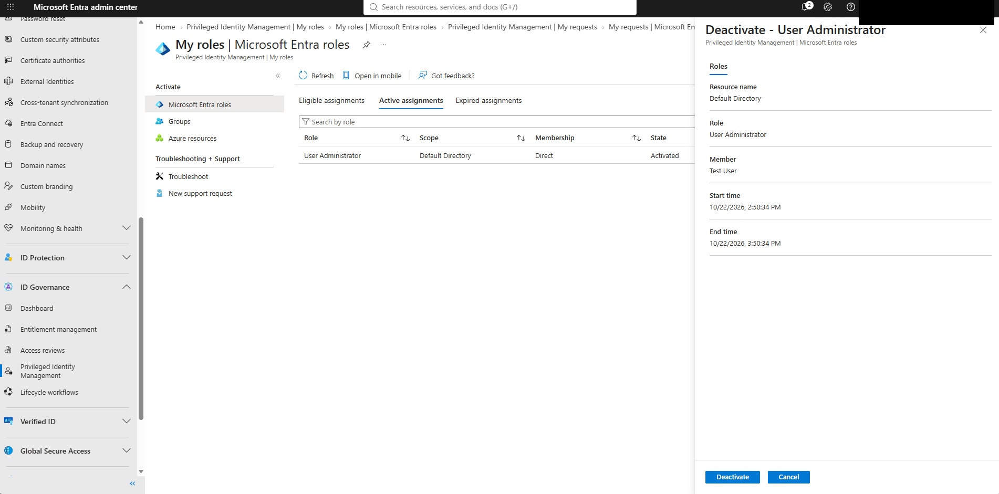

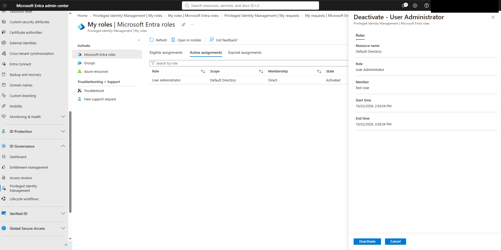

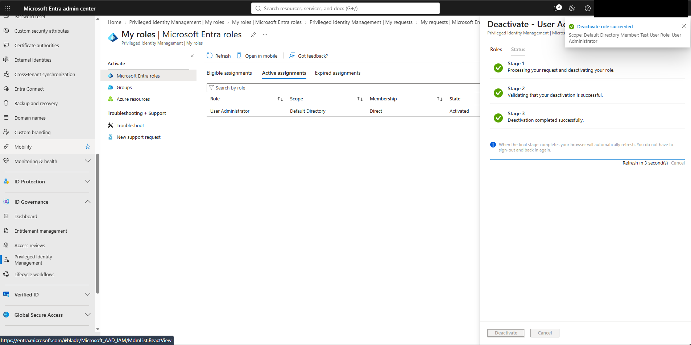

